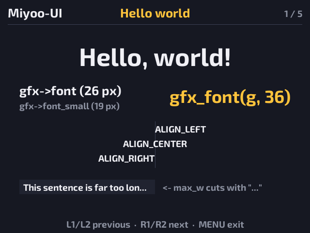
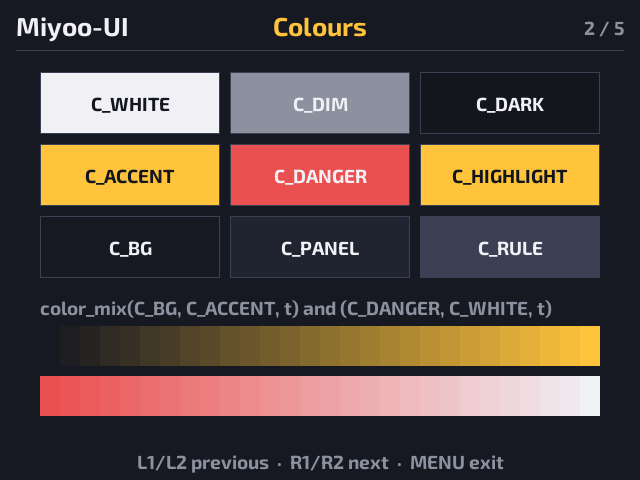
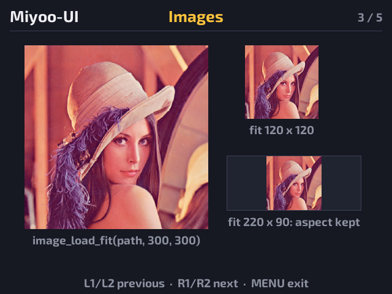
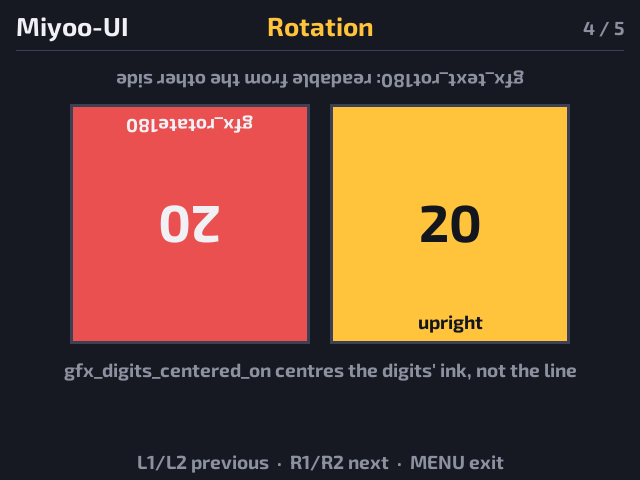
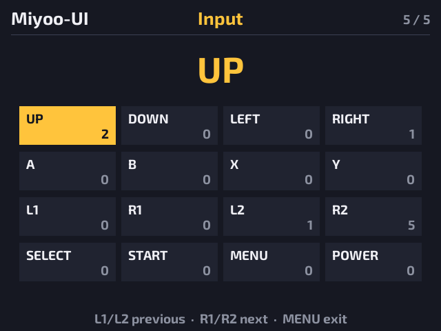

# Miyoo-UI

The shared UI code for native [OnionOS](https://github.com/OnionUI/Onion) apps on the Miyoo Mini and Mini Plus, written in C99 for SDL 1.2 and SDL_ttf. It's used by:

- RHSM: Retro Handheld Save Manager
- Life Counter: MTG-style life counter

## What's in it

| Header | What it does |
|---|---|
| `mui/gfx.h` | 640x480 display with an off-screen buffer, the standard fonts (`gfx_init_font()` for another font, e.g. the Onion theme's, or other sizes) plus `gfx_font(size)` for other sizes, fills, borders, blits, text with `...` truncation, scrolling (marquee) text, UTF-8 prefixes, 180° rotation and rotated text, centred digits |
| `mui/image.h` | Load a PNG or JPG and scale it to fit a box with smooth area-averaging, e.g. Onion box art. Needs `-lSDL_image` |
| `mui/color.h` | `color_text_on(bg)` picks readable text for a fill; `color_mix` blends two colours (for fades) |
| `mui/glyphs.h` | Button icons in hint text: `glyph_hint(gfx, gfx->font_small, icons, "{DPAD} move   {A} pick", ...)`. Tags for the face buttons, D-pad and shoulders; also drawn upside down or into an off-screen surface. Falls back to words if the icon font is missing |
| `mui/onion.h` | The current Onion theme: `onion_theme_font()` finds its list font the way Onion does (system.json → theme config.json → profile overrides → Onion's stock font) |
| `mui/theme.h` | Screen size, font path and sizes, the base colours (`C_WHITE`, `C_DIM`, `C_BG`, `C_PANEL`, `C_ACCENT`, `C_DANGER`, ...) |
| `mui/input.h` | Miyoo Mini buttons, mapped from Onion's SDL key events |
| `mui/screen.h` | `ScreenResult`: `SCREEN_OK` / `SCREEN_DONE` / `SCREEN_EXIT` |
| `mui/log.h` | `LOG_INFO` / `LOG_WARN` / `LOG_ERROR` to stderr; `LOG_DEBUG` only in debug builds |

`res/fonts/` holds the fonts:
- Exo 2 Bold for text (SIL OFL 1.1, see `OFL.txt`)
- Esquire Generic Gamepad Font V2, `CL` variant, for the button icons (Apache License 2.0, see `EsquireGenericGamepdFont_LICENSE.txt`)

`third_party/cjson/` is [cJSON](https://github.com/DaveGamble/cJSON) 1.7.18 (MIT), built into `libmui.a`; apps can `#include "cJSON.h"` too.

Apps add their own layout and colours in their own `ui/theme.h`, which includes `mui/theme.h` first.

## Demo

`demo/` is a small OnionOS app that shows each part of the library on its own page:

1. **Hello world**: font sizes, `gfx_font()`, the three alignments, truncation with `...`
2. **Colours**: the theme colours with `color_text_on` labels, and `color_mix` gradients
3. **Images**: the Lenna test image (`demo/res/images/lenna.png`) loaded with `image_load_fit` into three box sizes
4. **Rotation**: an upright panel next to a `gfx_rotate180` one, `gfx_text_rot180`, `gfx_digits_centered_on`
5. **Input**: the last button pressed and a press count for every button

**L1/L2** go to the previous page, **R1/R2** to the next, **MENU** exits.

Screenshots from a Miyoo Mini Plus:

| | |
|---|---|
|  |  |
| 1. Hello world | 2. Colours |
|  |  |
| 3. Images | 4. Rotation |
|  | |
| 5. Input | |

```sh
cd demo
make            # cross-compile in Docker and stage dist/App/MiyooUIDemo
make zip        # dist/MiyooUIDemo.zip, unzip onto the SD card root
make deploy HOST=<device ip>
```

The demo builds against the library in the folder above it, using Onion's `aemiii91/miyoomini-toolchain` image directly.

## Using it from an app

Clone Miyoo-UI next to the app (`../Miyoo-UI`). In the app's Makefile:

```make
# host side: mount the library into the toolchain container
MUI_DIR      ?= ../Miyoo-UI
MUI_HOST_DIR := $(shell cd "$(MUI_DIR)" 2>/dev/null && pwd)
DOCKER_RUN   := docker run --rm --platform linux/amd64 \
	-v "$(CURDIR)":/root/workspace -v "$(MUI_HOST_DIR)":/root/Miyoo-UI \
	-w /root/workspace $(DOCKER_IMAGE)
#   ... $(DOCKER_RUN) make MUI_DIR=/root/Miyoo-UI _dist

# container side, after CC / AR / CFLAGS / BUILD_DIR
include $(MUI_DIR)/mui.mk
CFLAGS += $(MUI_CFLAGS)

$(BUILD_DIR)/$(TARGET): $(OBJS) $(MUI_LIB)
	$(CC) $(LDFLAGS) -o $@ $^ -lSDL_ttf -lSDL -lpthread -lm

# when staging the app
	cp -r $(MUI_FONTS) $(APP_DIST)/res/
```

The library is compiled with the app's own `CFLAGS` into `build/<variant>/mui/libmui.a`, so `DEBUG=1` applies to it too. The linker only pulls in the modules an app actually uses.

## License

[MIT](LICENSE) © 2026 Jelly-Fish-Dev. The fonts keep their own licenses: Exo 2 under SIL OFL 1.1, the Esquire gamepad font under Apache 2.0 (both in `res/fonts/`).
